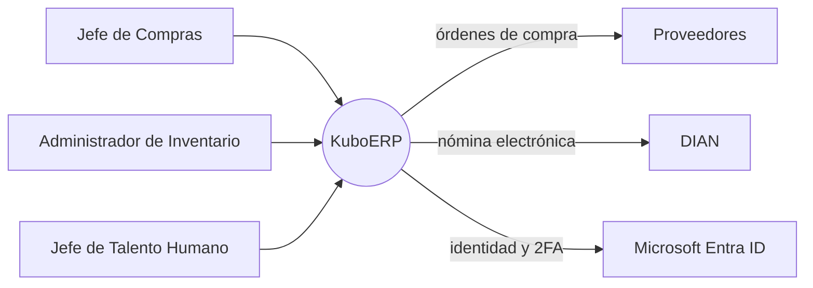
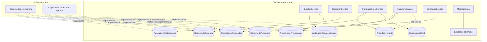
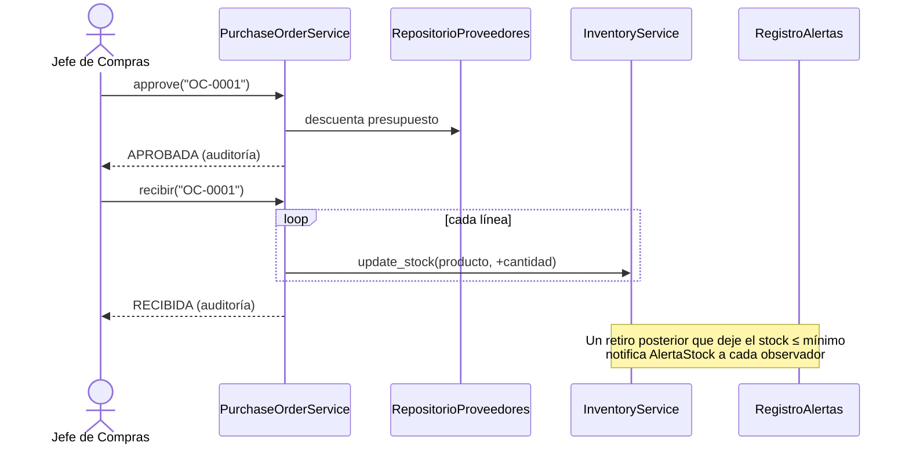

# KuboERP · Documentación de arquitectura (arc42)

**Versión 2.0 · Sprint 2 · 9 de noviembre de 2026** · Plantilla arc42 v8 (Starke y Hruschka)
Alcance de esta versión: incremento de **Proveedores y Compras, Inventario y Bodega y Talento Humano (nómina)**.

| Versión | Fecha | Cambio |
|---|---|---|
| 1.0 | 12 oct 2026 | Sprint 1: contexto C4, modelo 4+1, requerimientos no funcionales (RNF-01 a RNF-17) |
| 2.0 | 9 nov 2026 | Sprint 2: bloques del incremento en Python, SOLID, infraestructura con Terraform, CI con GitHub Actions y conceptos de seguridad |

---

## 1. Introducción y metas

KuboERP es el ERP de **ElectroSoluciones S.A.S.**, empresa que vende materiales eléctricos y presta servicios
técnicos de instalación, mantenimiento y reparación. El Sprint 2 construye el primer incremento ejecutable de los
módulos internos.

**Requerimientos principales del incremento**

| Historia | Qué hace el incremento |
|---|---|
| EP05-US01, US02, US04 | CRUD de proveedores: NIT único y válido, consulta, actualización y desactivación lógica |
| EP05-US07 | Solicitudes y cotizaciones: registro, consulta ordenada por precio, selección de la ganadora y anulación |
| EP05-US05, US06 | Órdenes de compra con líneas de producto: crear, aprobar contra presupuesto, recibir (entrada de inventario) y cancelar con justificación |
| EP01-US04, EP07-US02, US03, US04 | Inventario: registro, entradas y salidas, **stock mínimo y alerta de stock crítico**, inactivación lógica |
| EP06-US01 a US05 | Empleados y **motor de nómina** con devengado polimórfico, deducciones y aportes de 2026 |

**Metas de calidad (top 3)**

| Prioridad | Meta | Escenario medible |
|---|---|---|
| 1 | Corrección (RNF-02) | La nómina coincide al peso con los casos calculados a mano (pruebas `test_sprint2_nomina.py`) |
| 2 | Mantenibilidad (RNF-14, RNF-15) | Cobertura ≥ 80 % verificada en cada push; servicios desacoplados del almacenamiento |
| 3 | Seguridad (RNF-11 a RNF-13) | Sin secretos en el código; acceso a datos solo con identidades de Entra ID; auditoría de cambios de estado |

**Interesados**

| Rol | Expectativa |
|---|---|
| Gerencia General (patrocinador) | Control de compras y costos de nómina |
| Jefe de Compras | Órdenes trazables y proveedores confiables |
| Administrador de Inventario | Alertas antes de quedarse sin material |
| Jefe de Talento Humano | Nómina correcta y a tiempo |
| Docente / evaluador | Evidencia de Scrum, arc42, SOLID, IaC, CI y pruebas |

## 2. Restricciones

| Tipo | Restricción |
|---|---|
| Técnica | El taller exige Python y Google Colab para el incremento; el producto final sigue en C# / ASP.NET Core (Sprint 0) |
| Técnica | Nube Microsoft Azure; infraestructura como código con **Terraform** (ver ADR-03) |
| Organizacional | Scrum con sprints de 2 semanas; un solo integrante con los tres roles |
| Organizacional | No hay organización de Azure DevOps (cuenta bloqueada, ver acta del Sprint 2): tablero en GitHub Projects y CI en GitHub Actions |
| Legal | Ley 1581 de 2012 (datos personales), nómina electrónica DIAN, Decretos 1469 y 1470 de 2025 (SMMLV y auxilio 2026) |

## 3. Contexto y alcance

| Vecino | Entrada | Salida |
|---|---|---|
| Proveedor | Cotizaciones | Órdenes de compra aprobadas |
| DIAN | CUNE / rechazos | Documentos de nómina electrónica (sprint futuro) |
| Microsoft Entra ID | Token del usuario | Solicitud de autenticación |

## 4. Estrategia de solución

| Decisión | Motivo |
|---|---|
| Arquitectura en capas con puertos y adaptadores | Los servicios de dominio no conocen la base de datos (RNF-15) |
| Repositorios como protocolos de Python (`repositorios.py`) | Inversión de dependencias: hoy memoria, mañana Azure SQL |
| Borrado lógico en todos los CRUD | Trazabilidad y cumplimiento legal |
| Observer para el stock crítico | Nuevos canales de alerta sin modificar el inventario |
| Polimorfismo para el devengado | Cada tipo de empleado calcula su salario; el motor no pregunta el tipo |
| TDD + BDD + CI | La Definition of Done se verifica sola en cada push |

## 5. Vista de bloques

| Bloque (archivo) | Responsabilidad |
|---|---|
| `proveedores.py` | CRUD de proveedores |
| `cotizaciones.py` | Solicitudes y cotizaciones |
| `ordenes.py` | Ciclo de vida de la orden de compra y log de auditoría |
| `inventario.py` | Productos, kardex, stock crítico y alertas |
| `talento_humano.py` | Jerarquía de empleados y CRUD |
| `nomina.py` | Motor de nómina y parámetros anuales |
| `repositorios.py` | Contratos (puertos) |
| `excepciones.py` | Errores de negocio |

## 6. Vista de tiempo de ejecución

**Recepción de una orden de compra**

## 7. Vista de despliegue

Definida en `infra/terraform/` y validada por GitHub Actions.

| Recurso de Azure | Configuración de seguridad |
|---|---|
| App Service Linux (Python 3.12, plan B1) | Solo HTTPS, TLS 1.2, FTPS deshabilitado, identidad administrada |
| Azure SQL (Basic) | Autenticación exclusiva de Entra ID, TLS 1.2, retención de copias de 7 días |
| Key Vault (RBAC) | Protección contra purga; la app solo tiene el rol *Key Vault Secrets User* |
| Application Insights + Log Analytics | Telemetría y disponibilidad (RNF-09), retención de 30 días |

Ambientes: `dev` y `test` (`ambientes/*.tfvars`). El estado de Terraform vive en una cuenta de almacenamiento de Azure.

## 8. Conceptos transversales · Seguridad

| Concepto | Cómo se aplica | RNF |
|---|---|---|
| Identidad | Usuarios internos con Microsoft Entra ID y 2FA; la app usa identidad administrada, sin contraseñas | RNF-11 |
| Secretos | Ningún secreto en el repositorio. GitHub Actions se autentica en Azure con **OIDC** (credencial federada), sin client secret | RNF-11 |
| Mínimo privilegio | Roles RBAC por recurso; el workflow tiene `permissions: contents: read` | RNF-11 |
| Cifrado | TLS 1.2+ en App Service y SQL; TDE activado por defecto en Azure SQL | RNF-12 |
| Auditoría | Cada cambio de estado de una orden queda en el log (orden, estado anterior, nuevo, detalle); en producción se persistirá en una tabla de solo inserción | RNF-13 |
| Validación de entrada | Toda regla de negocio se valida en el servicio y lanza una excepción de dominio | RNF-02 |
| Datos personales | Borrado lógico de empleados y proveedores; el historial se conserva (Ley 1581 de 2012) | — |
| Cadena de suministro | Acciones de GitHub de publicadores verificados en versión mayor fija; dependencias de Python declaradas en `requirements.txt` | — |

**Modelo de amenazas (STRIDE resumido)**

| Amenaza | Ejemplo en KuboERP | Mitigación |
|---|---|---|
| Suplantación | Alguien aprueba órdenes con credenciales robadas | Entra ID + 2FA, roles por módulo |
| Manipulación | Cambiar el monto de una orden aprobada | Estados inmutables tras aprobar; auditoría |
| Repudio | "Yo no cancelé esa orden" | Log con usuario, fecha y justificación obligatoria |
| Divulgación | Fuga de salarios | Cifrado, rol exclusivo de Talento Humano |
| Denegación de servicio | Saturación de la API | Plan escalable de App Service, monitoreo |
| Elevación de privilegios | Credenciales de despliegue filtradas | OIDC con credenciales de corta vida, ambiente `test` protegido |

**Otros conceptos**: borrado lógico, excepciones de negocio en español, parámetros legales configurables (`ParametrosNomina`).

## 9. Decisiones de arquitectura

| ADR | Decisión | Estado | Consecuencia |
|---|---|---|---|
| ADR-01 | Arquitectura en capas + DDD (Sprint 0) | Aceptada | Bloques por bounded context |
| ADR-02 | Repositorios como `typing.Protocol` | Aceptada | Los servicios se prueban en memoria, sin base de datos |
| ADR-03 | **Terraform en lugar de Bicep** | Aceptada · reemplaza la DoD del Sprint 1 | Sintaxis multi-nube que pide el taller; proveedor `azurerm` 4.x |
| ADR-04 | **GitHub Actions en lugar de Azure Pipelines** | Aceptada | Impedimento del Sprint 2 (cuenta de Azure DevOps bloqueada); CI junto al código |
| ADR-05 | Parámetros de nómina en un objeto inmutable | Aceptada | Cambio anual del SMMLV sin tocar el motor |

## 10. Requisitos de calidad

| Escenario | Estímulo | Respuesta esperada | Verificación |
|---|---|---|---|
| Q1 Corrección | Calcular la nómina de un técnico con 10 h extra | Neto exacto al peso | `test_tecnico_con_horas_extra_y_auxilio_de_transporte` |
| Q2 Mantenibilidad | Push a cualquier rama `sprint-*` | Pruebas, BDD y cobertura ≥ 80 % en < 5 min | Job `pruebas-python` |
| Q3 Portabilidad | Crear el ambiente `test` desde cero | Recursos listos con un solo `terraform apply` | Job `terraform` + `plan-azure` |
| Q4 Fiabilidad | Retiro que deja el cable en su mínimo | Alerta al tablero y cantidad sugerida | `test_sprint2_inventario_critico.py`, `stock_critico.feature` |

## 11. Riesgos y deuda técnica

| Riesgo / deuda | Impacto | Acción |
|---|---|---|
| Repositorios solo en memoria | Los datos no persisten | Adaptadores de Azure SQL en el sprint 3 |
| Sin capa de API | Aún no hay endpoints | FastAPI con OpenAPI (equivalente al Swagger de la DoD) |
| Fondo de Solidaridad Pensional simplificado al 1 % | Error en salarios ≥ 16 SMMLV | Agregar tramos adicionales |
| `terraform apply` no ejecutado | No hay ambiente real | Activar Azure for Students y correr `plan-azure` |
| Decreto del SMMLV 2026 con controversia judicial | Valores pueden cambiar | Están en `ParametrosNomina` |
| Revisión por pares imposible (trabajo individual) | Menor detección de defectos | Revisión asistida + checklist en el PR |

## 12. Glosario

| Término | Definición |
|---|---|
| SMMLV | Salario mínimo mensual legal vigente: $1.750.905 en 2026 |
| IBC | Ingreso base de cotización a seguridad social |
| Stock crítico | Existencia igual o menor al stock mínimo del producto |
| Kardex | Registro de entradas y salidas de un producto |
| OIDC | OpenID Connect: GitHub obtiene un token temporal de Azure sin guardar contraseñas |
| IaC | Infraestructura como código |
| DoD | Definition of Done |
